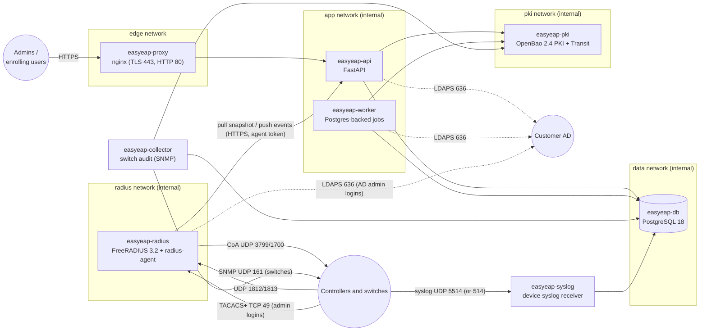
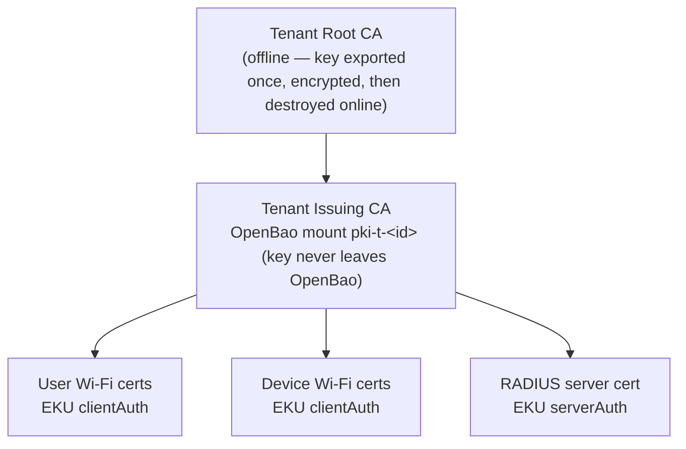
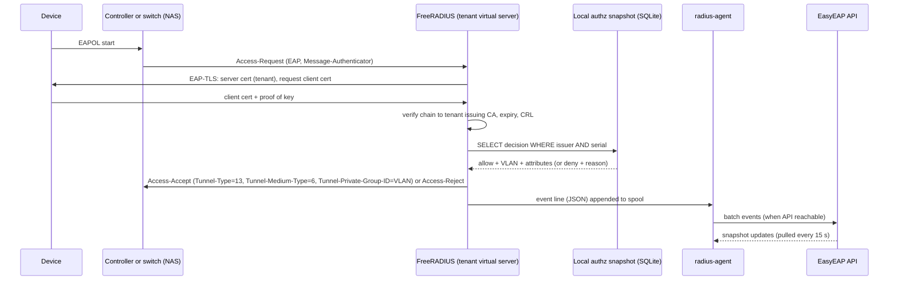

# EasyEAP Architecture

EasyEAP is a multi-tenant platform: one deployment, operated by an MSP, serves many customer organisations ("tenants"). Each tenant has its own PKI, directory connection, access policy, RADIUS configuration and audit trail. The design goal is that **authentication keeps working when anything above RADIUS is down**, and that **every failure denies rather than permits**.

## 1. Services

| Container | Image base | Runs as | Purpose |
|---|---|---|---|
| `easyeap-proxy` | nginx-unprivileged 1.31 | uid 101 | Serves the console SPA and the enrollment portal, terminates TLS, proxies `/api`, serves CRLs and OCSP on plain HTTP (clients fetch them without TLS by design). |
| `easyeap-api` | python 3.13-slim | uid 10001 | REST API (OpenAPI at `/api/docs`), authentication, RBAC, policy engine, PKI orchestration, enrollment, snapshot publisher, event ingestion. |
| `easyeap-worker` | same image as api | uid 10001 | Background jobs: directory sync, hourly policy recomputation (which keeps the snapshot fresh while the directory is healthy), CRL rotation, RADIUS server certificate rotation (checked every 6 hours), retirement of superseded client certificates, enrollment-link expiry, purge of undelivered server-generated keys, event retention, OpenBao token renewal. |
| `easyeap-collector` | same image as api | uid 10001 | Switch audit: polls monitored Cisco switches over SNMP (at most eight at once, every minute by default), keeps the latest result per switch and opens or resolves findings. |
| `easyeap-syslog` | same image as api | uid 10001 | Receives syslog from switches and controllers (UDP 5514, and 514 with `docker-compose.syslog514.yml`), decodes it and stores it per tenant. No route to OpenBao. |
| `easyeap-db` | postgres 18-alpine | postgres | Application database. Row-level security isolates tenants. |
| `easyeap-pki` | openbao 2.4.1 | openbao | One PKI secrets-engine mount per tenant (issuing CA), one Transit key per tenant (envelope encryption of tenant secrets). Static auto-unseal from a key file. Raft/file storage on its own volume. |
| `easyeap-radius` | freeradius 3.2.10 | freerad | FreeRADIUS plus `radius-agent` (Python) under a small supervisor. Renders and validates its own configuration from the API's desired state, keeps a local authorization snapshot, ships events. The agent also supervises EasyEAP's TACACS+ service for device administration (`tacacs.py`) while any tenant has a device with admin logins on. |

Only `easyeap-proxy` (TCP 80/443), `easyeap-radius` (UDP 1812/1813 and the dedicated range 1820–1839, and TCP 49 for TACACS+ when `EASYEAP_TACACS_BIND` names a reachable address) and `easyeap-syslog` (UDP 5514, and 514 with `docker-compose.syslog514.yml`, when `EASYEAP_SYSLOG_BIND` names a reachable address) publish ports. The API is never published directly. RADIUS has **no route** to the database or to OpenBao; it only talks to the API over an authenticated channel, and it keeps working without it.

## 2. Multi-tenancy

- Every tenant-scoped table has `tenant_id`. PostgreSQL **row-level security** policies compare it with `current_setting('easyeap.tenant_id')`, which the API sets per transaction after authorising the caller for that tenant. Platform tables (tenants, admins, platform audit) have no RLS and are only reachable through platform-scoped endpoints. The application connects as a non-owner role so RLS cannot be bypassed accidentally.
- **PKI isolation:** each tenant gets its own Root CA (kept offline) and Issuing CA (OpenBao mount `pki-t-<tenant_id>`). A certificate from one tenant never chains to another tenant's trust anchor, so it cannot authenticate on another tenant's Wi-Fi even with shared RADIUS infrastructure.
- **RADIUS isolation:** each RADIUS client (wireless controller) belongs to exactly one tenant. Requests are routed by client to the tenant's own virtual server, with its own EAP instance, server certificate, trusted CA chain, CRL and authorization snapshot. Controller source addresses must be unique across tenants; when two tenants' controllers share an address range (overlapping RFC 1918 over VPNs), the tenant is given a dedicated authentication/accounting port pair.
- **Secrets:** AD bind passwords, RADIUS shared secrets, TACACS+ keys, SNMP credentials, the Group Policy keytab, pending enrollment tokens and escrowed PKCS#12 blobs are encrypted with the tenant's OpenBao Transit key (envelope encryption). Deleting a tenant deletes its Transit key and PKI mount, so its ciphertext becomes unrecoverable (crypto-shredding).
- **RBAC:** platform roles (`platform_owner`, `platform_operator`, `platform_auditor`) apply to all tenants; tenant roles (`tenant_admin`, `pki_admin`, `wifi_admin`, `auditor`) are granted per tenant. Issuing certificates (`certificates:issue`) is a separate permission from managing CAs (`ca:manage`). See SECURITY.md for the permission matrix.

## 3. PKI

### Engine evaluation

| Option | Verdict |
|---|---|
| OpenSSL CLI (`openssl ca`) | Rejected. Text `index.txt` database, shell-out parsing, no concurrency, no API. |
| Smallstep step-ca | Excellent single-CA server (ACME, SCEP, templates, CRL). One authority per process, so per-tenant CAs would need a process or container per tenant and orchestration with Docker-socket access. No OCSP responder. |
| EJBCA CE | Mature but heavyweight (Java/WildFly), complex to automate, more than this product needs. |
| Custom CA on pyca/cryptography | Maximum control, but EasyEAP would own CA correctness, CRL/OCSP generation and key storage. Rejected per the "no custom PKI" rule. |
| **OpenBao PKI (chosen)** | Open-source (MPL-2.0, Linux Foundation) Vault fork. Unlimited PKI mounts (one per tenant), roles as certificate templates, keys generated and held inside OpenBao (`internal`), CRL + delta CRL with auto-rebuild, built-in OCSP responder, ACME, tidy, audit devices, policies per mount. Transit engine reused for envelope encryption. Static seal gives unattended restarts. |

### CA hierarchy per tenant

**Root ceremony** (setup wizard, step "Initialize PKI"): EasyEAP mounts a temporary engine, generates the root with `type=exported`, generates the issuing CA's CSR inside the tenant mount (`intermediate/generate/internal`), signs it with the root, sets the signed certificate, issues the root CRL, then **unmounts the temporary engine (destroying the online copy of the root key)**. The root private key is returned to the administrator exactly once, encrypted (PKCS#8, AES-256, PBKDF2) under a passphrase they choose, for offline storage. Later root operations (renewing the issuing CA, re-issuing the root CRL) reopen a ceremony by uploading that file. A lab-only "keep root online" option exists and is labelled insecure.

**Templates** map to OpenBao roles (`ext_key_usage`, `key_usage`, `ttl`/`max_ttl`, key type/bits, `allowed_*` names). The EasyEAP API is the registration authority: it builds subjects and SANs from directory data and the template's patterns, never accepting client-chosen subjects.

**Revocation:** `revoke` by serial → OpenBao rebuilds the CRL (auto-rebuild + delta) and OCSP answers immediately → EasyEAP marks the certificate revoked, recomputes the tenant snapshot and pushes it to RADIUS (seconds), and if the certificate's device has an active session on a CoA-capable controller, sends a Disconnect-Request. See §5 for honest latency.

**CRL/OCSP distribution:** the proxy serves `http://<pki-host>/pki/<tenant>/crl` and `/ocsp` (plain HTTP, as RFC 5280 clients expect). CRL distribution point and AIA URLs are set on each mount.

## 4. Enrollment and key custody

Every device gets its own certificate. Methods, in order of preference:

| Method | Where the key is generated | Platforms |
|---|---|---|
| Windows helper (PowerShell, `certreq` with the Microsoft Platform Crypto Provider when a TPM exists) | Device (TPM / non-exportable when available) | Windows |
| Browser enrollment (WebCrypto P-256 key, CSR built in-page, PKCS#12 assembled in-page) | Device browser; the private key never leaves the page | Android, Linux, macOS, Windows, iOS/iPadOS (profile assembled in-page) |
| CSR upload | Wherever the user generated it (e.g. `openssl` / NetworkManager) | Linux, advanced users |
| Server-generated (admin mode, opt-in per tenant) | OpenBao `issue` endpoint; EasyEAP immediately wraps the key in a password-protected PKCS#12 (AES-256-CBC, PBKDF2-SHA256, 600k iterations), encrypts it with the tenant Transit key, and allows **one** download before the escrow row is purged (or 72h expiry) | All |

One-time enrollment links carry a random 256-bit token (stored hashed, and kept encrypted while pending so an administrator can show the link again), bound to tenant + identity + device name, single use, 72h default expiry. Platform packages include the issuing chain, the Root CA, a Wi-Fi profile (Windows WLAN XML, Apple `.mobileconfig` with EAP-TLS + `TLSTrustedServerNames`, NetworkManager keyfile, wpa_supplicant block) and step-by-step instructions. Apple SCEP/ACME device-key enrollment is planned (see PROGRESS.md).

## 5. RADIUS authentication flow

- **Authorization data is precomputed.** The policy engine evaluates every certificate's holder against the tenant's rules whenever directory data, rules, certificates or account state change, and publishes a per-tenant snapshot: `serial → {decision, vlan, reply attributes, rule id, reason, valid_until}`. RADIUS performs one indexed lookup on a local SQLite file. There is **no synchronous call to the API, the database, AD or OpenBao during authentication**.
- **Fail closed:** unknown serial → reject (`cert_unknown`); snapshot missing or older than the tenant's `max_snapshot_age` (default 24h) → reject (`snapshot_stale`); decision deny → reject with reason. AD unreachable → the last successfully synced state continues to apply until it ages past the limit; accounts AD reports as disabled/locked/deleted are denied at the next sync.
- **Freshness:** directory sync every 15 min (configurable) and on demand; certificate, rule and revocation changes republish immediately. The agent pulls every 15 seconds (and on SIGHUP), so a change reaches RADIUS within about 15 seconds. Snapshot age is shown on the dashboard and enforced by RADIUS.
- **Revocation latency, honestly:** new authentications are rejected within seconds of revocation (snapshot + CRL). A device **already connected** keeps its session until it re-authenticates: controllers re-authenticate on `Session-Timeout` (default 8h, tenant-configurable) and may skip full EAP on roaming (PMK caching / OKC / 802.11r). For controllers with CoA enabled, EasyEAP sends a Disconnect-Request immediately to end the session (UDP 3799; Catalyst 9800 defaults to 1700). TLS session resumption is disabled by default so a resumed session cannot bypass the snapshot check.
- **Blast-RADIUS (CVE-2024-3596):** `limit_proxy_state = yes` on every client, and `require_message_authenticator = yes` on every client except switches registered for wired whose MAC authentication requests come without it (Nexus, Cisco Business, Meraki MS, classic IOS before 12.2(50)SE; `cisco_platforms.py`). From those, a request that carries Proxy-State without Message-Authenticator is still dropped. RADIUS/UDP must not cross untrusted networks; use a site-to-site VPN, or RadSec where the controller supports it (planned).
- **Wired 802.1X** ([plan and critique](docs/plans/wired-8021x.md)). Each RADIUS client is registered for Wi-Fi, wired or both (`radius_clients.networks`). FreeRADIUS decides which network a request is, in this order: a `Called-Station-Id` of the form `MAC:` with an empty SSID (hostapd's wired form) → wired; `NAS-Port-Type` Ethernet → wired, Wireless-802.11 → Wi-Fi; the client's only registered network; an SSID in `Called-Station-Id` → Wi-Fi, otherwise wired. A request for a network the client isn't registered for is rejected (`network_not_enabled`) before EAP; a MAC authentication request (`Service-Type = Call-Check`) from a client without MAC authentication is rejected as `mab_not_enabled`. Nested registrations (a switch inside a controller's range) resolve to the longest prefix, in FreeRADIUS and in EasyEAP's event attribution and CoA.
- **VLANs on switch ports.** Each decision has a Wi-Fi VLAN and a wired VLAN (`decisions.wired_vlan_id`), from each VLAN's `wired_mode`: the same VLAN, none (the port keeps its own), or another ID. The snapshot carries both; the agent stores the wired VLAN in `authz_wired`, tied to the snapshot version, so any mix of agent, configuration and API versions falls back to the Wi-Fi VLAN (1.0.1 behaviour) and never to another decision.
- **Monitor mode.** A switch whose port plan is in monitor mode is rendered with `easyeap_monitor = yes`: FreeRADIUS still decides and logs, but sends no Tunnel or extra attributes, and the event records the VLAN it would have assigned. The switch's own configuration keeps its ports open. Enforce is an explicit, audited step; the console asks for the switch's session list first.
- **MAC authentication** ([plan and critique](docs/plans/mac-auth.md)). A switch with MAC authentication on is rendered with `easyeap_mab = pap` (Cisco MAB: PAP with the MAC as user and password, `Calling-Station-Id` must match) or `eap` (UniFi MAC-Based: EAP-MD5 in its own `eapmd5_<tenant>` module, so `eap_<tenant>` stays TLS-only). A request is MAB only with positive wired evidence; everything else takes the EAP-TLS path. The MAC is normalised once and looked up in `authz_mac` for the current snapshot version (devices in groups, each group with its switch VLAN): unknown, expired, blocked or group off → reject with the reason, and the attempt is recorded as a sighting ("Seen, not allowed"). Blocks, expiry and group changes reach live sessions by CoA (Disconnect, or a Cisco re-authenticate / bounce CoA-Request).
- **Device administration** ([plan and critique](docs/plans/device-admin.md)). `tacacs.py` is an asyncio TACACS+ server (RFC 8907) on TCP 4949 in the container, published as 49. It reads `admin.json` (0600), which the agent writes from the snapshot's admin part: devices with admin logins on and their keys (plus the previous key during the 24-hour rotation grace), local accounts with scrypt hashes and TOTP secrets, roles, AD group mappings with SIDs, and the directory's TLS settings; it expires with the snapshot age limit. Local accounts are checked against their hash; AD users bind as themselves over verified LDAPS or StartTLS, and RootDSE `tokenGroups` of that connection gives their groups, nested included. Real denials answer FAIL; outages, stale data, key mismatches and break-glass names answer ERROR so IOS falls back to its local accounts. Failures are answered after a uniform delay; AD failed binds are capped below the domain's lockout threshold. Events (commands masked by `tacmask.py`, identical to the API's `app/admin/mask.py`) go to the agent's spool and `POST /api/agent/admin-events`.
- **Switch audit** ([plan and critique](docs/plans/switch-audit.md)). `easyeap-collector` (the API image, `entrypoint.sh collector`) polls each monitored Cisco switch over SNMPv2c or SNMPv3 (`app/switchaudit/snmp.py`, a small BER/USM client) for its ports, CISCO-AUTH-FRAMEWORK-MIB sessions (where the switch has them) and err-disabled ports, stores the latest result per switch, and compares it with EasyEAP's own answers (`findings.py`; two polls to open or resolve a finding). `easyeap-syslog` (`entrypoint.sh syslog`; [plan](docs/plans/syslog-full.md)) receives UDP syslog from switches and controllers. A datagram goes to the device with the longest matching claim: a registered address, or an extra syslog address, of a device with syslog on, or a switch's SNMP management address once a poll there has succeeded; an address two devices or tenants could claim is dropped. It keeps the whole log, coalesced per identical message per minute, decodes what it knows (802.1X/MAB sessions, err-disable, RADIUS servers, configuration changes, wireless clients: kept 14 days; the rest 3 days), and writes in the tenant's own session, within per-device rate limits and a daily byte quota per tenant. A message can move a switch's next poll earlier but never opens a finding. Both hold only the application role's password; the collector decrypts SNMP credentials through OpenBao Transit, and the syslog receiver has no route to OpenBao. Neither feeds RADIUS.
- **Configuration management:** the agent fetches the desired state (tenants, clients, virtual servers, certificates) from the API, renders FreeRADIUS configuration from templates, validates it with `freeradius -C` in a staging directory, swaps it atomically and restarts FreeRADIUS; on validation failure it keeps the running configuration and reports the error to the API (shown in System Health). Shared secrets reach the agent over the authenticated channel and live only on the RADIUS volume (mode 0600).

## 6. Access-policy precedence

Deterministic, documented in the UI, identical in the backend engine and the UI preview:

1. **Account gate:** directory account disabled, locked out or deleted → deny (not overridable).
2. **Certificate gate:** revoked or expired → deny.
3. **Explicit deny:** any enabled Deny rule matching any of the identity's groups (transitive, including the primary group via `tokenGroups`) → deny. Deny always wins.
4. **First allow:** the enabled Allow rule with the lowest priority number wins (ties broken by rule id; the UI prevents ties). Its VLAN and extra attributes are returned.
5. **Default:** the tenant default (deny unless an administrator configures allow + default VLAN).

Every decision stores its full trace (`steps`), shown as "why this VLAN" on the user page and in authentication logs.

**Staged changes.** The console never edits live rules one at a time. An administrator edits a draft (rules in order plus the tenant default), asks for an impact preview, and publishes:

- `POST /api/tenants/{id}/policy/preview` evaluates both the live policy and the draft for every user (per certificate purpose they hold) against the current directory data and returns who is newly allowed, newly denied or moves VLAN, with the draft's decision trace. It never writes.
- `POST /api/tenants/{id}/policy/publish` replaces the rules, their order and the default in one transaction, recomputes decisions and republishes the snapshot. Each draft carries the `revision` (a fingerprint of the live policy) it started from; a stale draft is refused with 409, so two administrators can't silently overwrite each other. The impact summary is written to the audit log.

**Posture and the needs-action queue** (`app/posture.py`). For each tenant the API reports whether RADIUS can enforce it (CA, server certificate, at least one controller, tenant active), when its local snapshot would fail closed (`snapshot_built_at + max_snapshot_age`), whether the worker is still refreshing it, and whether the agent has applied the latest version. The dashboard's queue lists what needs action, ranked by severity, then time until users are affected, then how many people are affected; every item names one action and the screen that performs it.

## 7. Directory (Active Directory)

LDAPS (636) or LDAP + StartTLS with certificate verification against an uploaded CA bundle; plain LDAP is refused unless explicitly enabled in Advanced settings. Read-only service account. Users are keyed by `objectGUID`; transitive group membership comes from `tokenGroups` (resolving the primary group such as *Domain Users*, which `memberOf` omits); account state from `userAccountControl` (disabled) and `msDS-User-Account-Control-Computed` (locked out). Users missing from a full sync are marked deleted and denied. Library: `ldap3` (pure Python) with explicit TLS context.

## 8. Data model (summary)

| Domain | Tables |
|---|---|
| Platform | `tenants`, `admins` (Argon2id hash, TOTP secret ciphertext), `admin_sessions` (token hash), `role_grants`, `platform_settings`, `jobs`, `audit_events` (hash-chained: each row stores `sha256(prev_hash ‖ canonical_row)`; UPDATE and DELETE revoked from the application role), `system_logs` (30 days) |
| PKI | `certificate_authorities` (metadata + PEM, never private keys), `certificate_templates`, `certificates` (with what renews each one, its last check-in and the certificate it renewed), `renewal_settings` (what renews by itself, from which percentage of a certificate's life, retirement of renewed certificates) |
| Identity | `directory_configs` (bind secret ciphertext, last sync status and stats), `directory_groups`, `identities`, `identity_groups`, `devices` |
| Policy | `vlans` (with what switch ports get), `access_rules`, `access_rule_groups`, `policy_settings`, `decisions` (per certificate, with trace and the wired VLAN) |
| RADIUS | `radius_settings` (snapshot version and build time, server key ciphertext and the previous one's for 14 days after a rotation, wired enrollment on/off), `radius_clients` (secret ciphertext, networks served, the switch's port plan and rollout mode), `auth_events` (network, switch port, monitor), `accounting_sessions`, `coa_requests`, `agent_status` |
| Enrollment | `enrollments` (token hash, token ciphertext while pending, method, status, expiry, a Windows setup file's choices), `key_escrow` (ciphertext, one-time) |
| Group Policy autoenrollment | `autoenroll_configs` (settings, keytab ciphertext, response-signing key ciphertext), `autoenroll_events` (request log) |
| MAC authentication | `device_groups` (switch VLAN), `mac_devices` (normalised MAC, status, expiry, last seen), `mac_sightings` (MACs switches asked about) |
| Switch audit and syslog | `switch_states` (latest poll per switch), `switch_findings` (open, resolved, acknowledged), `switch_syslog` (every message from switches and controllers, coalesced per minute; decoded ones 14 days, the rest 3), `syslog_stats` (today's counters per device); on `radius_clients`: `monitoring`, the SNMP credentials' ciphertext and `syslog` (on/off, extra addresses) |
| Device administration | `admin_roles` (privilege level), `admin_users` (scrypt hash, TOTP secret ciphertext, sites, expiry), `admin_group_maps` (AD group → role, ordered), `admin_settings` (local-only names, log retention), `admin_events`; on `radius_clients`: `admin_enabled` and the TACACS+ key ciphertexts |

Migrations: Alembic, run automatically by the api container on start (`alembic upgrade head`) under an advisory lock.

## 9. Frontend

React 19 + TypeScript + Tailwind CSS v4 + Radix primitives, React Router (hash routes) and TanStack Query. Two production entries:

- **Console** (`index.html`, `src/app/`): the design direction chosen in `design/CONCEPTS.md`, Concept F ("Modern Security Management") with Concept D's needs-action queue and Concept E's command palette. A search-first sidebar is scoped to the current tenant (`/`), and a command palette (Ctrl/Cmd+K) starts entity actions such as issue, revoke, rotate secret and test a user. The decision ledger renders the backend's decision trace on the user page, in Test a user and in the policy preview. Each status carries the age of its source data, and "allowed by policy" is shown separately from "can connect".
- **Enrollment portal** (`enroll.html`, `src/enroll/`): the end-user flow behind a one-time link. The default path generates the key pair on the device with WebCrypto, builds the CSR and PKCS#12 in the page with PKI.js, and never sends or stores the private key.

The design prototypes (`design.html`, `src/concepts/`, `src/prototype/`) are a separate entry that only `vite build --mode design` emits; their synthetic data never ships in the production bundle. Mutations carry the CSRF header; no secret reaches the browser except one-time displays (a new shared secret, an enrollment link, a server-generated package password, the encrypted root-key file from the CA ceremony) and audited showings on request (a stored shared secret, TACACS+ key or SNMP credentials filled into a configuration, for an administrator who may rotate it; a pending enrollment link or Windows setup file given again).

## 10. Technology decisions

| Decision | Choice | Why |
|---|---|---|
| Backend | Python 3.13, FastAPI, SQLAlchemy 2, Alembic, Pydantic v2, psycopg 3 | Mature ecosystem for LDAP, X.509 (pyca/cryptography for packaging and parsing only), RADIUS tooling; typed OpenAPI. |
| Jobs | In-database job table + worker loop (`SELECT … FOR UPDATE SKIP LOCKED`) | No extra broker container; jobs survive restarts; simple to back up. |
| PKI | OpenBao PKI + Transit | See §3. |
| RADIUS | FreeRADIUS 3.2.10 | Stable branch with Blast-RADIUS mitigations, `rlm_sql_sqlite`, `linelog`, CRL reload. |
| Passwords | Argon2id (argon2-cffi) | Memory-hard, current OWASP recommendation. |
| MFA | TOTP (RFC 6238) | Works offline, no external dependency. |
| Proxy | nginx-unprivileged | Non-root, small, well understood. |
