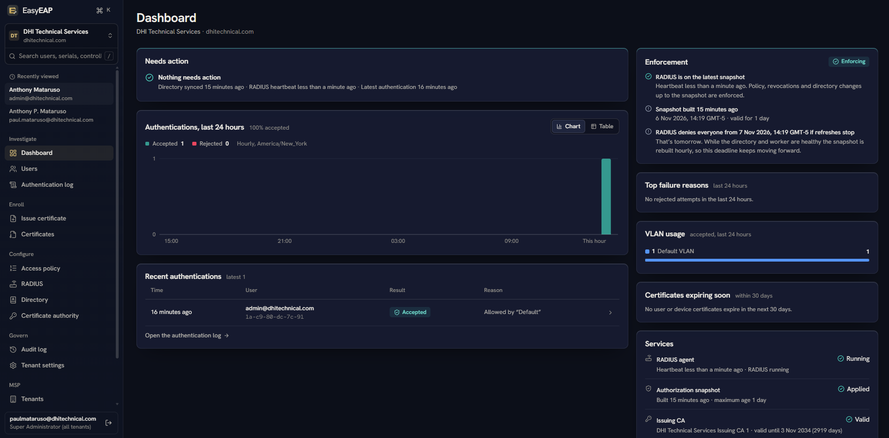
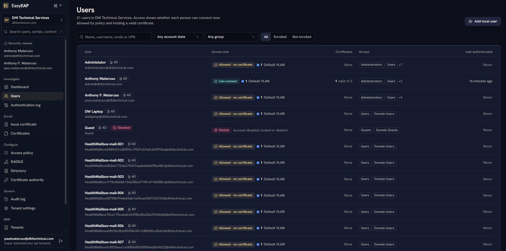
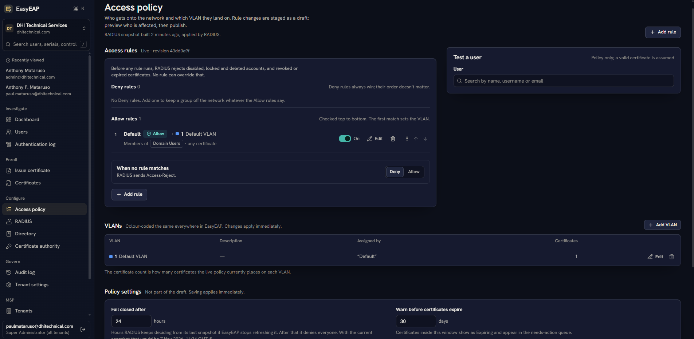
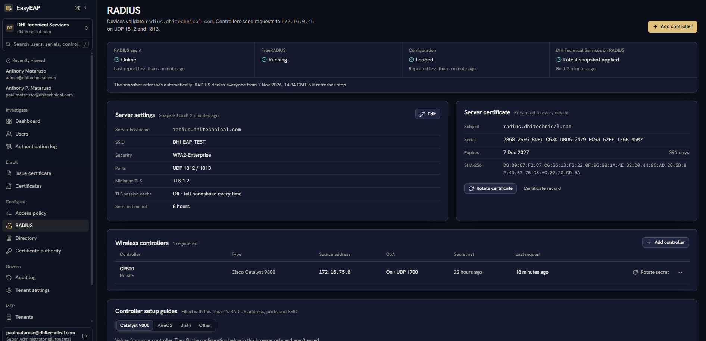
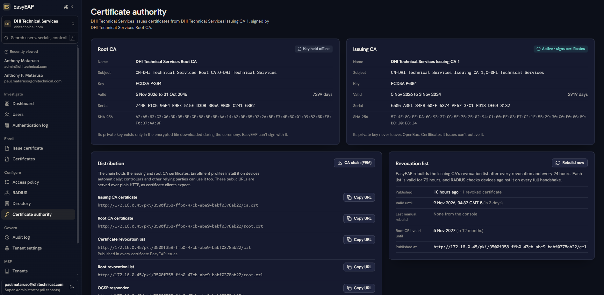
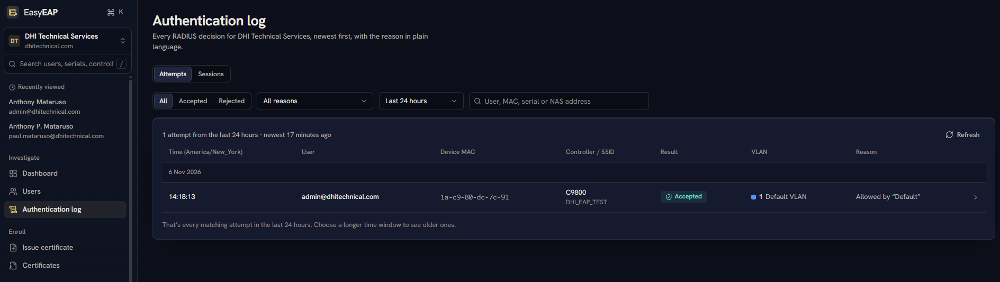
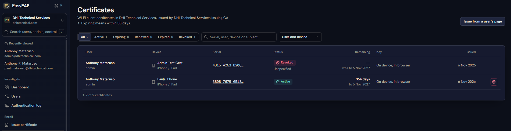
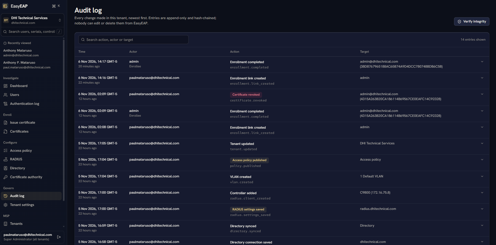
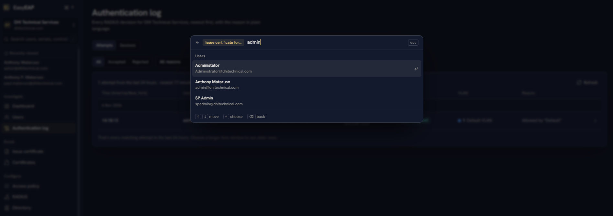
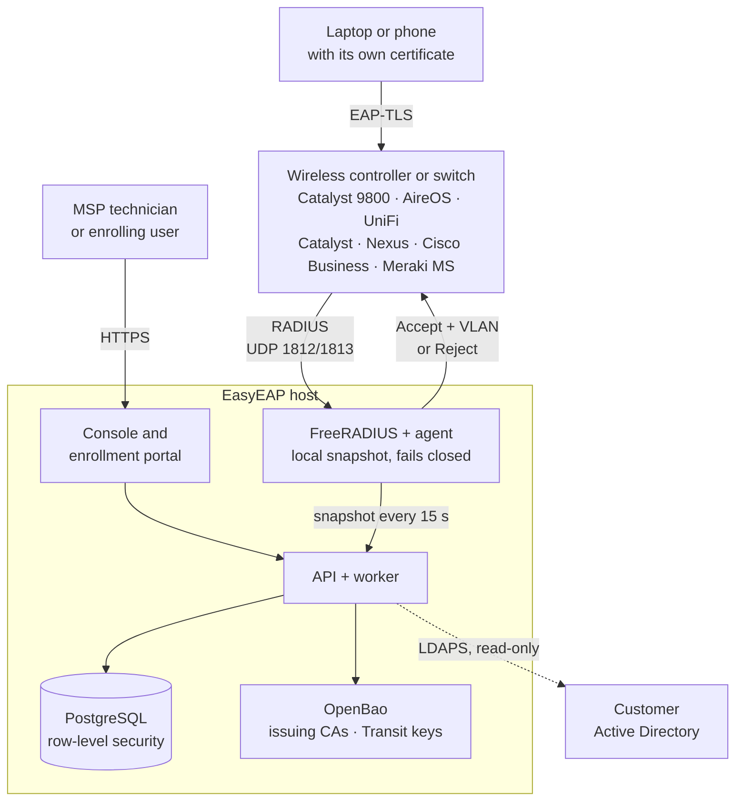

<div align="center">


# EasyEAP

**Enterprise Wi-Fi authentication, simplified.**

Certificate-based Wi-Fi and wired 802.1X (EAP-TLS) for MSPs and IT teams. EasyEAP bundles a certificate authority,
Active Directory groups, dynamic VLANs and FreeRADIUS, and runs them all from one multi-tenant console.

[](https://github.com/paulmataruso/EasyEAP/releases/latest)
[](https://github.com/paulmataruso/EasyEAP/actions/workflows/ci.yml)
[](LICENSE)
[](docs/controllers/cisco-catalyst-9800.md)

[Quick start](#quick-start) · [Tour](#a-tour-of-the-console) · [How it works](#how-it-works) · [Security](#security) · [Docs](#documentation) · [License](#license)

</div>

<br>

<p align="center">
  
</p>

## Why EasyEAP

A Wi-Fi password, whether a pre-shared key or a PEAP login, gets shared, phished and never rotated. EAP-TLS fixes
that: every device proves who it is with its own certificate, and there is no password to steal. Rolling it out,
though, usually means standing up a certificate authority, a RADIUS server, directory integration, and a network
access control suite built for a much bigger job.

EasyEAP does just that job: issue a certificate to a person's device, check their Active Directory groups, and put
them on the right VLAN. One deployment serves many customers. Every failure denies access instead of allowing it.

## What you get

<table>
<tr>
<td width="50%" valign="top">

**A certificate authority per customer**<br>
Each tenant gets an offline root CA, made in a one-time ceremony, and an issuing CA whose key lives in OpenBao and
never leaves it. CRL and OCSP are published automatically.

</td>
<td width="50%" valign="top">

**Active Directory, read-only**<br>
EasyEAP syncs users over LDAPS with a read-only service account. Nested groups (including the primary group) count,
and disabled, locked or deleted accounts are denied before any rule runs.

</td>
</tr>
<tr>
<td width="50%" valign="top">

**Dynamic VLANs where deny wins**<br>
*Deny Contractors · IT → VLAN 120 · Staff → VLAN 100.* Rule changes are staged as a draft and previewed against
every real user before you publish them.

</td>
<td width="50%" valign="top">

**RADIUS that doesn't need the console**<br>
FreeRADIUS authenticates from a local snapshot while the console, API or database is down. Once that snapshot is
older than the limit you set, it **fails closed** and denies everyone.

</td>
</tr>
<tr>
<td width="50%" valign="top">

**One certificate per device**<br>
Enrollment links work on Windows, macOS, iOS and iPadOS, Android and Linux. By default each device generates its own
key, in the browser or with the TPM on Windows. One setup file sets up a Windows 11 PC with the user's and the
computer's certificates, which renew themselves; domain PCs can instead get theirs through Group Policy
autoenrollment, as from AD CS (preview). Server-generated keys are opt-in.

</td>
<td width="50%" valign="top">

**Answers in plain language**<br>
Every decision says why: *Member of IT Dept via Network Team → rule 2 → VLAN 120*, or *Certificate from an untrusted
authority: re-enroll the device.*

</td>
</tr>
<tr>
<td width="50%" valign="top">

**Built for MSPs**<br>
Customers share one deployment, kept apart by PostgreSQL row-level security and per-tenant keys. A needs-action queue
shows which tenant needs you and why.

</td>
<td width="50%" valign="top">

**Backup, restore and syslog in the console**<br>
One encrypted file holds everything, and a new server restores it from its first-run page. The audit trail,
authentications and system log can forward to your SIEM over TLS.

</td>
</tr>
<tr>
<td width="50%" valign="top">

**MAC authentication for what can't do 802.1X**<br>
Printers, cameras and phones on switch ports get on by MAC address (Cisco MAB on Catalyst, Nexus and Cisco Business,
Meraki MS, UniFi MAC-Based), each group on its own VLAN. Switches report what they see, so you build the allow list in
monitor mode before you enforce.

</td>
<td width="50%" valign="top">

**Switch logins with AD accounts**<br>
Network administrators log in to Cisco switches and controllers with their AD account or an EasyEAP account over
TACACS+, with roles, an admin log of every command, and the device's local accounts as fallback.

</td>
</tr>
<tr>
<td width="50%" valign="top">

**A switch audit that checks the switch**<br>
EasyEAP reads what each Cisco switch reports over SNMP (v2c, or v3 encrypted) and compares it with its own answers:
unprotected ports, devices it never accepted or has since denied, sessions in the wrong VLAN. With syslog it also shows
what the switch says: 802.1X failures, err-disabled ports, RADIUS servers it can't reach. **Device syslog** shows
everything switches and controllers (Catalyst 9800, AireOS, UniFi, Meraki) send, live, decoded into sessions and
clients (Meraki's isn't decoded yet).

</td>
<td width="50%" valign="top">

**Certificates that renew themselves**<br>
Turn renewal on or off for user and device certificates and the RADIUS server certificate, and choose when it starts.
The Windows setup file and the Linux script check in daily and renew on their own; each certificate's page shows what
renews it and when it last checked in. The server certificate rotates by itself, and **Put the previous certificate
back** undoes a rotation.

</td>
</tr>
</table>

## A tour of the console

<table>
<tr>
<td width="50%" valign="top">
<br>
<b>Users.</b> Who can connect right now, on which VLAN, and why not when they can't.
</td>
<td width="50%" valign="top">
<br>
<b>Access policy.</b> Deny rules always win; the first matching Allow rule sets the VLAN. Test any user against the policy.
</td>
</tr>
<tr>
<td width="50%" valign="top">
<br>
<b>RADIUS.</b> Live status, the server certificate, controllers and switches (<b>Fill in the shared secret</b> puts it back in their configuration, audited), and controller guides filled in with this tenant's settings.
</td>
<td width="50%" valign="top">
<br>
<b>Certificate authority.</b> The offline root, the issuing CA, distribution URLs and revocation list health.
</td>
</tr>
<tr>
<td width="50%" valign="top">
<br>
<b>Authentication log.</b> Every RADIUS decision with the controller, SSID, VLAN and the reason in plain language.
</td>
<td width="50%" valign="top">
<br>
<b>Certificates.</b> Each device's certificate, how long it has left, and where its key was made. Revoke one with an optional CoA disconnect.
</td>
</tr>
<tr>
<td width="50%" valign="top">
<br>
<b>Audit log.</b> Every change, hash-chained so tampering shows. Verify the chain from the console.
</td>
<td width="50%" valign="top">
<br>
<b>Command palette.</b> Press <kbd>Ctrl</kbd>+<kbd>K</kbd> or <kbd>⌘</kbd>+<kbd>K</kbd> to issue, revoke or rotate from anywhere, or <kbd>/</kbd> to search the tenant.
</td>
</tr>
</table>

## How it works



1. The device presents its certificate to the controller (or the switch, on a wired port), which relays the EAP-TLS
   exchange to EasyEAP's FreeRADIUS.
2. FreeRADIUS checks the certificate against the tenant's issuing CA and revocation list. It then looks up the
   certificate in a local snapshot that already holds the account state, groups and policy decision.
3. RADIUS accepts with the VLAN (`Tunnel-Private-Group-ID`) or rejects. Either way the reason appears in the
   authentication log.
4. The agent pulls a fresh snapshot every 15 seconds, so a revocation stops new connections within about 15 seconds.
   Devices that are already connected are disconnected with CoA where the controller supports it.

The RADIUS container has no route to the database or OpenBao. [ARCHITECTURE.md](ARCHITECTURE.md) covers the services,
networks, PKI design, enrollment, policy precedence and data model.

## Quick start

You need a Linux host with Docker Engine 24+ and Docker Compose v2 (2 vCPU, 4 GB RAM, 20 GB disk), a DNS name for
the console, and a route from your wireless controllers and switches to the host.

```sh
git clone https://github.com/paulmataruso/EasyEAP.git /opt/easyeap
cd /opt/easyeap/deploy
sudo ./install.sh --hostname easyeap.msp.example --radius-address 10.20.0.15
```

The installer generates every secret, builds the images, starts the stack and prints a **one-time setup token**.
Open `https://easyeap.msp.example/` and choose one of two options:

- **Set up new:** paste the token, create the first administrator and add a tenant. A setup wizard walks you through
  the CA ceremony, the directory, RADIUS and the access policy.
- **Restore a backup:** paste the token and upload an `.easyeap` backup file. The server comes back as it was when
  the backup was made.

There is no default account. To try EasyEAP without a customer network, run `./install.sh --lab`. It adds a Samba
AD domain controller and a simulated Wi-Fi client. [DEPLOYMENT.md](DEPLOYMENT.md) covers ports, TLS certificates,
settings, upgrades, backups and operations.

## Controllers and switches

EasyEAP works with any controller that supports WPA2/WPA3-Enterprise with an external RADIUS server and VLAN
assignment from RADIUS attributes, and with switches running 802.1X on their ports. The console's RADIUS screen fills
in each guide with the tenant's own address, ports, SSID and VLANs.

| Controller or switch | Status | Guide |
|---|---|---|
| Cisco Catalyst 9800 (IOS-XE 17.x) | Verified on a live controller, CoA on UDP 1700 | [cisco-catalyst-9800.md](docs/controllers/cisco-catalyst-9800.md) |
| Cisco AireOS WLC 8.x | Guide and CLI snippet, CoA on UDP 3799 | [cisco-aireos.md](docs/controllers/cisco-aireos.md) |
| UniFi Network | Step-by-step guide, Wi-Fi and switches | [unifi.md](docs/controllers/unifi.md) |
| Cisco Catalyst switches (IBNS 2.0, classic IOS) | Wired 802.1X: Add switch wizard, monitor mode, then Enforce. A Catalyst 3850 (IOS-XE 16.6.1) took the configuration, accepted EAP-TLS in monitor mode, and ran the switch audit over SNMP and syslog. Enforce and MAB not yet verified on hardware | [cisco-catalyst-switch.md](docs/controllers/cisco-catalyst-switch.md) |
| Cisco Nexus switches (NX-OS) | Wired 802.1X and MAB, by model and release. Not yet verified on hardware | [cisco-nexus.md](docs/controllers/cisco-nexus.md) |
| Cisco Business (Catalyst 1200/1300, CBS, SG/SF) | Wired 802.1X, and MAB on the models that have it. Not yet verified on hardware | [cisco-business.md](docs/controllers/cisco-business.md) |
| Cisco Meraki MS | Wired 802.1X and MAC authentication, Dashboard steps, no CoA yet. Not yet verified on hardware | [meraki-ms.md](docs/controllers/meraki-ms.md) |

Switches start in monitor mode: EasyEAP logs what it would decide and sends no VLAN until you enforce. Where the switch
has an open mode its ports stay open; Nexus and most Meraki MS have none, so EasyEAP accepts their MAC requests
instead. Some Cisco Business models have no monitor mode and start with one test port.

## Security

EasyEAP decides who gets onto a network, so it fails closed and keeps keys where they belong.

- **No default account.** The first administrator is created with a one-time token from the server. Passwords are
  hashed with Argon2id, two-factor uses TOTP, and sign-in is rate-limited.
- **No custom cryptography.** It relies on OpenBao, pyca/cryptography, WebCrypto, PKI.js, argon2-cffi and age.
- **Key custody.** The root CA key is exported once, encrypted, and never kept online. Issuing CA keys never leave
  OpenBao. Shared secrets, bind passwords and escrowed keys are stored only as per-tenant Transit ciphertext.
  A switch's or controller's configuration can be shown again with its shared secret, TACACS+ key or SNMP
  credentials filled in, by administrators allowed to manage those secrets; each showing is in the audit log.
- **Tenant isolation.** PostgreSQL row-level security applies to every tenant table, through a non-owner application
  role.
- **Fails closed.** Unknown certificates, stale snapshots, and disabled, locked or deleted accounts are all denied.
- **Honest revocation.** New connections stop within about 15 seconds. Connected devices drop through CoA or at
  their session timeout. The console never claims revocation is instant.
- **Tamper-evident audit.** The audit trail is append-only and hash-chained, and can be verified from the console.

Read [SECURITY.md](SECURITY.md) for the threat model and key custody. To report a vulnerability, use
[private vulnerability reporting](https://github.com/paulmataruso/EasyEAP/security/advisories/new), not a public
issue.

## Documentation

| Document | What it covers |
|---|---|
| [DEPLOYMENT.md](DEPLOYMENT.md) | Requirements, network, install, first run, upgrades, backup and restore, remote syslog, operations |
| [ARCHITECTURE.md](ARCHITECTURE.md) | Services, multi-tenancy, PKI, enrollment, the RADIUS flow, policy precedence, the data model |
| [SECURITY.md](SECURITY.md) | Threat model, key custody, controls, the RBAC matrix, what revocation means in practice |
| [docs/controllers/](docs/controllers/README.md) | Cisco Catalyst 9800, Cisco AireOS, UniFi, and Catalyst, Nexus, Cisco Business and Meraki MS switch configuration |
| [docs/enrollment.md](docs/enrollment.md) | Issuing certificates and what users do on each platform |
| [docs/device-administration.md](docs/device-administration.md) | Switch and controller logins with AD and EasyEAP accounts over TACACS+ |
| [docs/switch-audit.md](docs/switch-audit.md) | The switch audit: what Cisco switches report over SNMP compared with EasyEAP's decisions, and their syslog |
| [docs/windows-setup.md](docs/windows-setup.md) | The Windows setup file: one download that sets up a PC, with computer certificates and renewal |
| [docs/windows-group-policy.md](docs/windows-group-policy.md) | Setting up domain-joined Windows PCs for 802.1X with Group Policy |
| [docs/autoenrollment.md](docs/autoenrollment.md) | Group Policy autoenrollment (preview): certificates for domain PCs and users from EasyEAP, as from AD CS |
| [docs/troubleshooting.md](docs/troubleshooting.md) | Every failure reason and status, and how to fix it |
| [DEVELOPMENT.md](DEVELOPMENT.md) | Repository layout, the development stack, tests, conventions |
| [DESIGN.md](DESIGN.md) | The console's design system |
| [PRODUCT.md](PRODUCT.md) | Who EasyEAP is for, what it's for, and its product principles |
| [docs/plans/](docs/plans/) | The design plans and critiques behind each feature |
| [CHANGELOG.md](CHANGELOG.md) · [PROGRESS.md](PROGRESS.md) | What changed; what's done, what isn't, and what's planned |
| [TODO.md](TODO.md) | What's left to build, and what still needs testing on real gear |

## Status and roadmap

**EasyEAP 1.1** adds wired 802.1X and MAC authentication on Cisco, Meraki and UniFi switches, switch logins over
TACACS+, the switch audit and device syslog, the Windows setup file and Linux setup script, Group Policy
autoenrollment (preview), and certificates that renew themselves. 1.0 was the first public release. EasyEAP has been
run end to end against a real Active Directory domain controller and authenticated an enrolled iPhone through a live
Cisco Catalyst 9800. Known limitations are listed in [PROGRESS.md](PROGRESS.md#not-done--known-limitations), and what's
left to build and test in [TODO.md](TODO.md). The main ones:

- No SCEP or MDM enrollment (Intune, Jamf) yet. Apple devices enroll with a configuration profile from the portal.
- No RadSec yet. Route RADIUS between sites over a VPN.
- One RADIUS node per deployment.
- Wired 802.1X has run on one Catalyst 3850 (IOS-XE 16.6.1): it took the configuration, accepted EAP-TLS in monitor
  mode, and ran the switch audit over SNMP and syslog. Enforce, MAC authentication, the other Cisco families, Meraki MS
  and UniFi switches are tested on real FreeRADIUS with real EAP-TLS, not yet on hardware. Device administration
  (TACACS+) is tested against a protocol client, not yet on Cisco hardware.
- The Windows setup file and Group Policy autoenrollment (preview) are tested against stand-ins, not yet on a real
  Windows PC.
- The root CA's revocation list must be re-signed with the offline root key once a year. The dashboard warns 60 days
  ahead, but the console can't do the re-signing yet.

Not built yet: the UniFi controller wizard (EasyEAP sets up a UniFi controller through its API), the rest of
certificate renewal (phases 3 to 7: assisted renewal for Apple, Android and hand-configured Linux, and the root
ceremony and CA rollovers from the console), and CoA for Meraki MS. Planned work also includes SCEP, RadSec, additional
RADIUS nodes, and email notifications for expiring certificates and failing directory syncs.

## Contributing

Bug reports and pull requests are welcome. Read [CONTRIBUTING.md](CONTRIBUTING.md) first, because contributions are
accepted under terms that keep the licensing below possible.

## License

EasyEAP is **source-available** under the [Business Source License 1.1](LICENSE). In plain terms:

- **Free:** reading, modifying, testing and evaluating it, and running it in production to secure the networks of
  your own organization.
- **Needs a commercial license:** running it to provide services to third parties. That includes managing customers'
  networks as an MSP, offering it as a hosted service, and selling or bundling it.
- **Becomes open source:** each version converts to the Apache License 2.0 four years after its release, on the
  Change Date in its LICENSE file. Versions 1.0.0 and 1.0.1 convert on 6 November 2030, 1.1.0 on 9 November 2030, and 1.2.0 on 10 November 2030.

The [LICENSE](LICENSE) text is the authoritative version of these terms. For a commercial license, email
[paulmataruso@dhitechnical.com](mailto:paulmataruso@dhitechnical.com). EasyEAP builds on FreeRADIUS, OpenBao, PostgreSQL,
nginx and other open-source projects under their own licenses; see
[THIRD-PARTY-NOTICES.md](THIRD-PARTY-NOTICES.md).

<p align="center"><sub>EasyEAP · Copyright © 2026 Paul Mataruso</sub></p>
